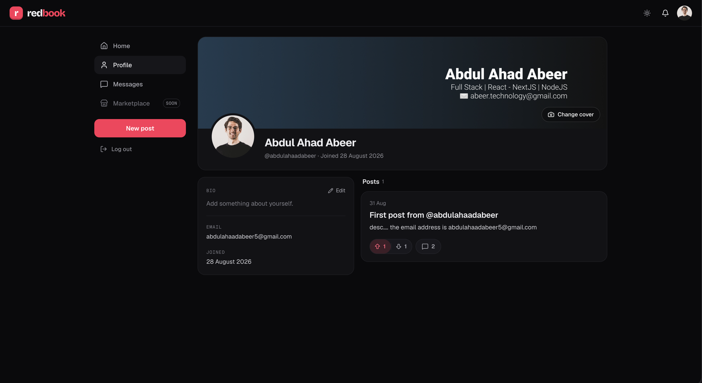

# Redbook

**Redbook** is a social media app built with the PERN stack (PostgreSQL, Express, React, and Node.js). You can try it in your browser through the live demo, or run it on your own machine with Docker.

## Live Demo

Try it out without any setup: **[redbook-client.abeer-technology.workers.dev](https://redbook-client.abeer-technology.workers.dev)**

This is hosted on free-tier services (Cloudflare Workers, Render, Neon). Two things worth knowing:

- **<ins>Slow first load is normal.</ins>** The server can take up to ~50 seconds to respond on the first request after a period of inactivity (it spins down after 15 minutes idle, then wakes back up) — this is not a bug.
- **<ins>Still broken? Run it locally.</ins>** If the live link is unresponsive or broken beyond that, it likely means something's off with the free-tier hosting rather than the code itself. In that case, use the Docker setup below to run it yourself.

## Watch The App Preview

[](https://www.youtube.com/watch?v=SJKd8GhW-iE)

## Run It Locally with Docker

> **Everything from here on is only for running Redbook on your own machine.** If you just want to see how it works, use the [live demo](#live-demo) instead — no setup required.

### 1. Prerequisites

- [Docker](https://docs.docker.com/get-docker/) with Docker Compose installed.
- A local copy of this repository:

  ```bash
  git clone https://github.com/abeertech01/redbook.git
  cd redbook
  ```

The project is split into two independent apps, wired together by Docker Compose:

```bash
redbook/
 client/              # Frontend (React)
 server/              # Backend (Express, Node.js)
 docker-compose.yaml
 ...
```

### 2. Set up environment variables

Copy the example env file in each app folder to `.env`:

```bash
cp client/example.env client/.env
cp server/example.env server/.env
```

Then fill in the values in each `.env`:

- **`server/.env`:** set `PORT=3030`, add any random string as `JWT_SECRET`, and add your [Cloudinary](https://cloudinary.com/) credentials (needed for profile and cover photo uploads). The Postgres values can stay as they are.
- **`client/.env`:** works as is.

### 3. Start the app

```bash
docker compose up -d
```

This builds and starts four services, in this order:

- **Database:** PostgreSQL, with data kept in a persistent volume.
- **Migration:** applies the Prisma schema so the database is ready, then exits.
- **Server:** the Node.js backend at http://localhost:3030.
- **Client:** the React frontend at http://localhost:5173.

Once everything is up, open **http://localhost:5173** in your browser. The database is filled with demo users and posts on first start.

### 4. Stop the app

```bash
docker compose down
```

This stops and removes the containers. Your data stays in the database volume and will still be there next time you start the app.

### Troubleshooting

- **Environment variables not loading:** make sure the files are named `.env` (not `example.env`) and sit in `client/` and `server/`.
- **Ports already in use:** the app needs ports 5173 (client), 3030 (server) and 5432 (database) to be free on your machine.

## Contributing

If you'd like to contribute to Redbook, feel free to fork the repository and submit a pull request. I welcome contributions that point out weak spots in the project.
